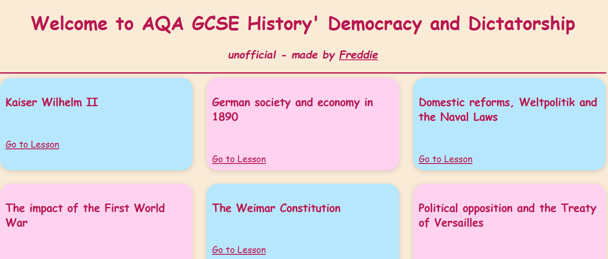

# german-history

I had a GCSE revision guide handy so decided to turn it into a Flask website that is not slop (**cough cough*, B\*tes\*ze).

This is a simple Flask Application that renders some HTML files about Germany from 1980s to just before Hitler becomes Chancellor. This information was taken from my schools GCSE Democracy and Dictatorship Revision Guide and actual Lesson Plans. The content is all written by my teacher but has been merged into the following files by a mix of hand moving, autoamtion (word to html w/ pyhton) and Claude.

## Screenshot

Demo: [history.freddieyershon.co.uk](https://history.freddieyershon.co.uk)

## Features

- Multiple History Lessons as HTML pages

- Unique Styling

- Move between Pages

## How to run it (_locally_)?

1. Clone the repo and cd into folder

2. Start a `.venv` and install dependancies

3. `python app.py`

## Credit

My schools History Dept. for the content

Claude for assisting with development 

## To Do's for a future update

- [x] Make `index` actually look good

- [x] style it so it lsooks less s\*it

- [ ] Add 'Lesson Finished' button to the end of every page

- [ ] Calculate % of lessons finished for end of index

- [ ] On final lesson complete celerbate with css confeti (that random css libary thing)

- [ ] Quiz?

- [ ] log in in with HCA and track stats? (admin view for me)